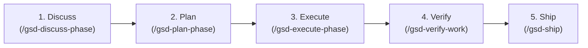

# Get Shit Done (GSD)

**Get Shit Done (GSD)** is a meta-prompting, context-engineering, and spec-driven development framework designed by TÂCHES / GSD-Build / Open-GSD. It turns high-level requirements into hierarchical, atomic plans, executing them phase-by-phase with isolated context budgets, state tracking, and verifiable commits.

---

## 1. Core Philosophy: Why GSD?

LLMs suffer from **context rot**: as long development conversations accumulate compiler output, file diffs, test logs, and raw source code, instruction following degrades, hallucinations increase, and execution quality drops.

GSD solves this through four architectural pillars:
1. **Lean Orchestrator / Fresh Subagents**: The main coordinator maintains high-level awareness (roadmap, phase, state), while research, plan creation, task execution, and verification run in fresh subagents or isolated context steps.
2. **Spec-Driven Execution**: Code is never written blindly. Every task begins with explicit requirements, acceptance criteria, and plan steps documented in `.planning/`.
3. **Persistent Project Memory**: Context survives session breaks. Everything is recorded in plain Markdown files under `.planning/` (`PROJECT.md`, `ROADMAP.md`, `STATE.md`).
4. **Verifiable Atomic Milestones**: Each task produces verifiable outcomes with passing automated checks before marking done.

---

## 2. Directory Layout (`.planning/`)

All GSD project state lives in `.planning/` at the root of the workspace:

```text
.planning/
├── config.json              # Workflow mode (interactive vs yolo), git commit settings
├── PROJECT.md               # Core vision, requirements, scope, constraints
├── REQUIREMENTS.md          # Traceable numbered requirements (REQ-01, REQ-02...)
├── ROADMAP.md               # Milestones, phases, and status
├── STATE.md                 # Project memory: current phase, blockers, recent decisions
├── codebase/                # Codebase map for brownfield repositories
│   ├── STACK.md             # Languages, frameworks, runtime versions
│   ├── ARCHITECTURE.md      # System design, data flow, component layout
│   ├── STRUCTURE.md         # Directory structure, key files
│   ├── CONVENTIONS.md       # Code style, naming, patterns
│   ├── TESTING.md           # Test suites, runners, test patterns
│   └── CONCERNS.md          # Technical debt, known issues, security considerations
├── phases/                  # Phased execution folders
│   ├── 01-foundation/
│   │   ├── 01-01-PLAN.md    # Actionable atomic plan with tasks
│   │   ├── 01-01-SUMMARY.md # Execution log, files modified, verification proof
│   │   ├── CONTEXT.md       # Decisions and scope from discuss phase
│   │   └── RESEARCH.md      # Domain and architectural research
│   └── 02-core-features/
└── debug/                   # Active and resolved debug logs
```

---

## 3. The 5-Phase Lifecycle



### Phase 1: Discuss (`/gsd-discuss-phase <N>`)
- Clarifies the vision, design direction, user experience, and constraints before planning.
- Questions assumptions: What is non-negotiable? What is explicitly out of scope?
- Outputs `CONTEXT.md` in `.planning/phases/XX-phase-name/`.

### Phase 2: Plan (`/gsd-plan-phase <N>`)
- Spawns research agents to investigate dependencies, APIs, and existing code patterns.
- Breaks down the phase into small, sequential plans (`XX-01-PLAN.md`, `XX-02-PLAN.md`).
- Each plan specifies:
  - Objective & User Value
  - Affected files
  - Step-by-step tasks
  - Definition of Done (automated checks, linting, unit tests)
- Outputs `RESEARCH.md` and `XX-YY-PLAN.md`.

### Phase 3: Execute (`/gsd-execute-phase <N>`)
- Spawns isolated executor subagents (or waves of parallel agents for independent plans).
- Follows TDD (Test-Driven Development) where appropriate.
- Runs compiler/linter/test suites after each atomic task.
- Produces atomic Git commits.
- Summarizes results into `XX-YY-SUMMARY.md`.

### Phase 4: Verify (`/gsd-verify-work <N>`)
- Runs User Acceptance Testing (UAT) and verification checklist against `REQUIREMENTS.md`.
- Identifies any regressions, edge-case failures, or UX discrepancies.
- Outputs `UAT.md` or remediation tasks.

### Phase 5: Ship & Milestone Completion (`/gsd-ship <N>` & `/gsd-complete-milestone`)
- Packages changes, runs end-to-end regression tests, generates release summary.
- Archives phase docs and updates `ROADMAP.md` and `STATE.md`.

---

## 4. Quick Command Reference

| Command | Purpose |
|---|---|
| `/gsd-new-project` | Initialize greenfield project (questioning → research → requirements → roadmap) |
| `/gsd-map-codebase` | Map brownfield codebase into `.planning/codebase/` (architecture, stack, conventions) |
| `/gsd-discuss-phase <N>` | Capture user vision and non-negotiables into `CONTEXT.md` |
| `/gsd-plan-phase <N>` | Generate atomic plans (`XX-YY-PLAN.md`) with task checklists and verification criteria |
| `/gsd-execute-phase <N>` | Execute plans with isolated subagent contexts and atomic commits |
| `/gsd-verify-work <N>` | Run conversational UAT against acceptance criteria |
| `/gsd-ship <N>` | Prepare pull request / merge branch and ship phase |
| `/gsd-quick "<task>"` | Fast ad-hoc task with GSD planning directory & atomic commit guarantees |
| `/gsd-fast "<task>"` | Inline change (≤3 files) without subagents |
| `/gsd-debug "<symptom>"` | Systematic debugging session that survives context clears |
| `/gsd-capture <idea>` | Capture ideas, notes, seeds, or backlog items in `.planning/` |
| `/gsd-progress` | Check where you are, what's done, and what's next |

---

## 5. Working with Subagents in Antigravity

When running GSD within Antigravity:
1. **Coordinator**: Keeps top-level control, displays progress checklist via `update_steps`, and maintains `.planning/STATE.md`.
2. **Subagents (`invoke_subagent`)**:
   - `TypeName: "research"`: Read-only codebase exploration and doc lookups.
   - `TypeName: "self"`: Full-write subagent assigned to execute a single `XX-YY-PLAN.md`.
   - `TypeName: "image-generator"`: Generates visual or photographic assets when needed.
3. **Context Preservation**:
   - When a phase finishes, update `.planning/STATE.md`.
   - Never hoard giant file diffs in the main context; write findings to files in `.planning/`.

---

## 6. Resources & References

- **Templates**: Available in `templates/` (`PROJECT.md`, `REQUIREMENTS.md`, `ROADMAP.md`, `STATE.md`, `PLAN.md`, `SUMMARY.md`, `UAT.md`).
- **Agent Roles**: Detailed role prompts available in `agents/` (`gsd-planner.md`, `gsd-executor.md`, `gsd-verifier.md`, `gsd-code-reviewer.md`, etc.).
- **Official Upstream**: [gsd-build/get-shit-done](https://github.com/gsd-build/get-shit-done) / [open-gsd/gsd-core](https://github.com/open-gsd/gsd-core).
